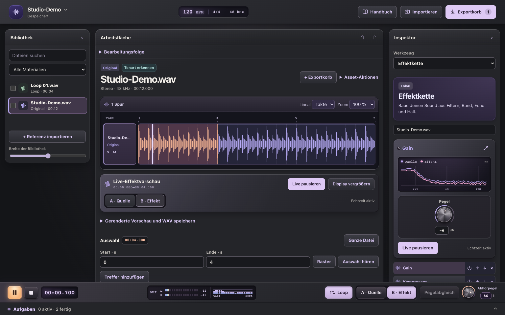
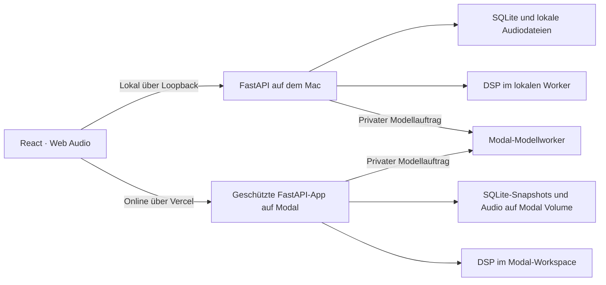

# Dreamtelligence Artist Workspace

Ein privates Audiostudio im Browser für **Stem Separation, Audio-to-MIDI, Sampling, Live-Effekte und Mastering**. Aus einem Track werden separate Stems, aus einer Bassspur wird editierbares MIDI. Originalaufnahmen, Referenzen und gerenderte Varianten bleiben im selben Projekt. Ausgewählte Ergebnisse gehen als WAV und MIDI an Ableton Live oder Logic Pro.

[Geschütztes Online-Studio öffnen](https://studio.dreamtelligence.de/) · [Beispiel für einen DAW-Export herunterladen](docs/verification/artist-workspace/beispiel-loop.zip)

[Funktionen](#funktionen) · [Modelle und Audioverarbeitung](#modelle-und-audioverarbeitung) · [Architektur](#architektur) · [Lokaler Start](#lokal-auf-dem-mac-starten) · [Prüfstand](#prüfstand)

## Funktionen

| Bereich | Was du im Studio machen kannst |
| --- | --- |
| **Stem Separation** | Einen Track in **Vocals, Drums, Bass und Begleitung** zerlegen oder eine **Instrumentalversion** ohne Gesang erzeugen. Die ausgewählten Spuren landen als einzelne WAV-Dateien im Projekt. |
| **Audio-to-MIDI** | Mit Basic Pitch Noten und Pitch Bends aus einer Einzelspur wie Bass oder Gitarre erkennen. MuScriptor liefert aus einem Song je nach Auswahl Instrumenten- und Drum-MIDI, Akkorde und eine Tempokarte. Noten im MIDI-Editor anpassen, quantisieren und transponieren. |
| **Loops, Samples und Tonart** | Vorschläge für Tempo, Taktraster, Tonart und Anschläge übernehmen oder korrigieren. Ganze Takte oder freie Ausschnitte als Loops speichern und mehrere One-Shots in einem Durchgang schneiden. Tempo und Tonhöhe mit Rubber Band unabhängig ändern. |
| **Live-Effekte und Remix-Mixer** | Effekte in einer Kette anordnen, bis zu 30 Sekunden live bearbeiten und Quelle und Effektsignal im A/B-Vergleich hören. Ausschnitte mit Ausklang oder ganze Clips als WAV rendern. Stems mit Pegel, Panorama, Schnitt und Startversatz als Stereomix ausgeben. |
| **Mastering und Audioprüfung** | Einen Mix automatisch mastern oder mit Matchering an eine Referenz anlehnen. Lautheit (LUFS), True Peak und stille Abschnitte prüfen. |
| **Sprachbearbeitung** | Hintergrundgeräusche mit MossFormer, DeepFilterNet oder RNNoise reduzieren. Pausen und Störstellen markieren und bestätigte Schnitte als neue Fassung rendern. |
| **Sound-Generierung und AudioSR** | Aus Text bis zu drei kurze Audio-Takes erzeugen. Mit AudioSR Basic experimentell hohe Frequenzen in einem Ausschnitt von bis zu 15 Sekunden ergänzen. |
| **DAW-Export und Projektsicherung** | Ausgewählte WAV- und MIDI-Dateien mit Manifest als ZIP exportieren. Audiotracks auf Wunsch nach ihrer Startposition ausrichten. Projektpakete mit Audiodateien sichern und wieder öffnen. |

### Stem Separation im Studio

Track importieren, in der **Bibliothek** auswählen und im **Inspektor → Werkzeug → Stems trennen** die gewünschten Spuren anhaken. **Mel-Band RoFormer** übernimmt Gesang und Instrumentalversion. **SCNet XL IHF** liefert die übrigen Stems und kann alle vier Stems als zusammengehörige Gruppe berechnen. Die WAVs erscheinen nach dem Lauf in der Bibliothek und unter **Aufgaben**.

### Live-Effekt-Rack

Zur Auswahl stehen **Gain, Hochpass, Tiefpass, parametrischer EQ, Kompressor, Noise Gate, Limiter, Hall, Delay, CHOW Tape, CHOW Matrix und Dragonfly Plate**. Im Studio erklärt das **Handbuch** alle 19 Werkzeuge und 12 Effektmodule.



*Lokale Studio-Ansicht mit synthetischem Demomaterial.*

## Beispiel vom Track bis zur DAW

1. Importiere einen Track und trenne Drums und Bass als eigene Stems.
2. Markiere zwei Takte der Drumspur und speichere sie als WAV-Loop. Wandle die Bassspur mit **Basic Pitch** in MIDI um.
3. Lege den Loop und das Bass-MIDI in den **Exportkorb** und erstelle ein DAW-Paket. Ziehe die Dateien aus dem ZIP in dein Arrangement.

## Modelle und Audioverarbeitung

| Aufgabe | Engine | Ergebnis und Ausführung |
| --- | --- | --- |
| **Stem Separation** | [SCNet XL IHF und Mel-Band RoFormer](modal_app_zfturbo_complete.py) | Private Verarbeitung auf Modal. WAV-Ausgabe pro Stem. Der Hybridmodus kombiniert die Modelle. Die zusammengehörige Vierergruppe stammt aus einem SCNet-Lauf. |
| **Musiktranskription** | [MuScriptor large, Beat This und Essentia](modal_app_transcription.py) | Private Verarbeitung auf Modal. Je nach Auswahl Instrumenten- und Drum-MIDI, Tempoereignisse, Akkorde und Analyseberichte. |
| **Einzelspur zu MIDI** | [Basic Pitch](audio_core/engines.py) | Läuft im Workspace. Noten und Pitch Bends aus einer isolierten Instrumentenspur. |
| **Automatisches und Referenzmastering** | [Automatische Pedalboard-Kette](modal_app_matchering.py) und [Matchering](audio_core/engines.py) | Automatik auf Modal, Matchering im Workspace. Das gerenderte Ergebnis lässt sich auf Lautheit und True Peak prüfen. |
| **Sprache und Schnittvorschläge** | [MossFormer2, Whisper large-v3-turbo und AST](modal_app_enhancement.py), DeepFilterNet und RNNoise | Entrauschte Sprachvariante und auf Wunsch Vorschläge für Pausen und Störsegmente auf Modal. DeepFilterNet und RNNoise laufen im Workspace, wenn eingerichtet. |
| **Text zu Audio** | [Stable Audio Open 1.0](modal_app_audio_generation.py) | Bis zu drei separat gespeicherte Stereo-Takes pro Auftrag auf Modal. |
| **Bandbreite ergänzen** | [AudioSR Basic](modal_audiosr.py) | Optionaler Dienst auf Modal. Experimentelle WAV-Variante in Mono bei 48 kHz für kurze Ausschnitte. |
| **Schnitt, Tempo, Messungen und Effekte** | [FFmpeg, librosa, Rubber Band und Pedalboard](audio_core/engines.py) | DSP im Workspace. Die Live-Vorschau verarbeitet den gewählten Ausschnitt über einen WebSocket. WAV-Render und Export laufen als Aufträge. |

## Architektur

React, TypeScript und Vite bilden die Oberfläche mit Bibliothek, Wellenform, Inspektor und Transport. FastAPI verwaltet den Projektkatalog, Audiodateien und die Warteschlange. Lokal bindet die API an Loopback. Online führt die Studio-Domain über Vercel zur geschützten FastAPI-App auf Modal. Der Online-Workspace hält seinen Katalog und seine Audiodateien auf einem eigenen Modal Volume.



- **Originale und Varianten.** Der Katalog speichert Quellbezüge und Einstellungen pro Render. Bearbeitungen legen neue Assets an. Bei einem Neustart können Auftragsstatus und Ergebnisse wieder eingelesen werden.
- **Modellaufträge.** Der Server überträgt Audio in hashgeprüften Blöcken. Zur Wiederaufnahme eines Cloud-Auftrags dient die gespeicherte Remote-ID. Zugangsdaten für Modellworker bleiben serverseitig.
- **Live-Effekte.** Der Online-Workspace stellt ein kurzlebiges Einmal-Ticket für den Audioausschnitt aus. Die direkte WebSocket-Verbindung liefert Quelle und Effektsignal für den A/B-Vergleich. Der WAV-Export wird separat gerendert.

| Im Repository | Inhalt |
| --- | --- |
| [`web/src/`](web/src/) | Studio-Oberfläche, Audio-Transport, MIDI-Editor und Handbuch |
| [`studio/`](studio/) | FastAPI, Katalog, Auftragsverwaltung und Live-Stream |
| [`audio_core/`](audio_core/) | DSP, Schnitte, Timestretching und Pegelmessung |
| [`modal_artist_workspace.py`](modal_artist_workspace.py) | Online-App, Zugriffsschutz und Volume-Anbindung |
| [`hosting/artist-workspace/`](hosting/artist-workspace/) | Beispiel für das Routing der Studio-Domain |
| [`tests/`](tests/) | Regressionstests für Audio, Projektpakete und den privaten Cloud-Pfad |

## Lokal auf dem Mac starten

Voraussetzungen sind Node.js 22 mit npm sowie `uv`, FFmpeg mit Opus-Unterstützung und Rubber Band. Das Setup richtet die Python-3.11-Umgebung ein und installiert die festgeschriebenen Abhängigkeiten.

```sh
brew install uv ffmpeg rubberband
git clone https://github.com/dreamtelligence/XO-master.git
cd XO-master
npm run setup
npm start
```

Öffne [localhost:8765](http://localhost:8765). Falls der Port belegt ist, starte das Studio mit `npm start -- --port 8767`. Lokale Verarbeitung und Export funktionieren ohne Online-Konto. Für Cloud-Werkzeuge brauchst du [eigene private Modal-Zugangsdaten](docs/PRIVATE_MODE.md).

## Betrieb und Entwicklung

| Befehl | Zweck |
| --- | --- |
| `npm run build` | TypeScript prüfen und den Web-Build erzeugen |
| `npm test` | Lokale Regressionstests ausführen |
| `npm run dev` und `npm --prefix web run dev` | API und Vite in zwei Terminals für die Entwicklung starten |

Für eine eigene Online-Instanz beschreibt der Betriebsleitfaden den Modal-Deploy, die Secrets, den persistenten Speicher und das Routing der Studio-Domain. Der geschützte Online-Zugang ist ein gemeinsamer Workspace-Zugang. [Online-Betrieb und Deployment](docs/verification/2026-11-18-artist-workspace-online.md#neue-version-ausrollen)

## Prüfstand

- **Stem Separation mit einem vollständigen Track.** Aus einer 6:45 Minuten langen M4A entstanden fünf abrufbare Stereo-WAVs über die volle Tracklänge. Basic Pitch erzeugte aus der Bassspur MIDI. Das Online-Testprojekt deckte alle 19 Werkzeuge in 26 abgeschlossenen Aufträgen mit 45 Ergebnisdateien ab. [Online-Prüfbericht](docs/verification/2026-11-18-artist-workspace-online.md#abnahme-mit-einem-vollständigen-track)
- **WAV und MIDI auf gemeinsamer Zeitbasis.** Vier ausgerichtete Stereo-WAVs mit 48 kHz und 24 Bit sowie ein MIDI mit 128 BPM wurden auf Länge und Zeitbasis geprüft. [Messwerte des Exports](docs/verification/artist-workspace/aligned-summary.json)
- **Online-Wiedergabe und Wiederherstellung.** Browserprüfungen deckten Login, Upload, Live-Effektvorschau, A/B und ZIP-Download ab. Nach dem Rückimport eines Projektpakets stimmte die Prüfsumme der Originaldatei überein. [Browser- und Betriebsprüfungen](docs/verification/2026-11-18-artist-workspace-online.md#abnahme)
- **Offene Abnahme.** Der Import direkt in Ableton Live und Logic Pro, die systematische Hörprüfung und Tests unter größerer Last stehen noch aus. [Lokale Abnahmematrix](docs/verification/2026-11-18-artist-workspace.md#abnahmematrix)

## Dokumentation und Lizenz

- [Bedienung, lokale Installation und Projektsicherung](docs/ARTIST_WORKSPACE.md)
- [Private Modellworker einrichten](docs/PRIVATE_MODE.md)
- [Technische Projektplanung](docs/plans/2026-11-18-artist-workspace-plan.md)
- [Historische Plattform und alte Commerce-Komponenten](disabled/README.md)

Der Projektcode steht unter der [MIT-Lizenz](LICENSE). Modelle, Gewichte und Plugins haben eigene Lizenzbedingungen. Die technischen Nachweise nennen Versionen, Herkunft und die zugehörigen Bedingungen. [Versionen und Rechte](docs/verification/2026-11-18-artist-workspace.md#versionen-und-rechte)
